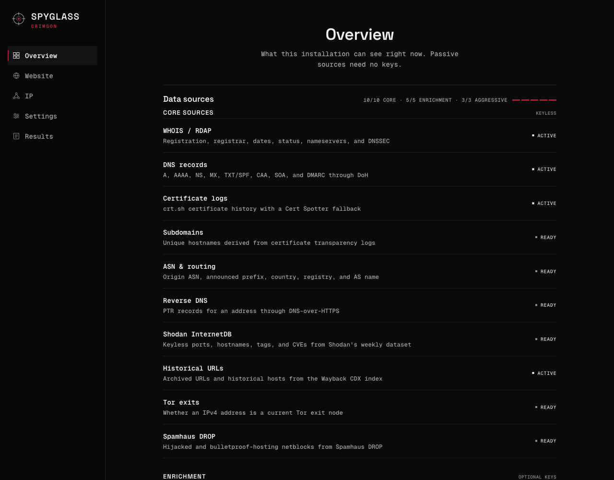
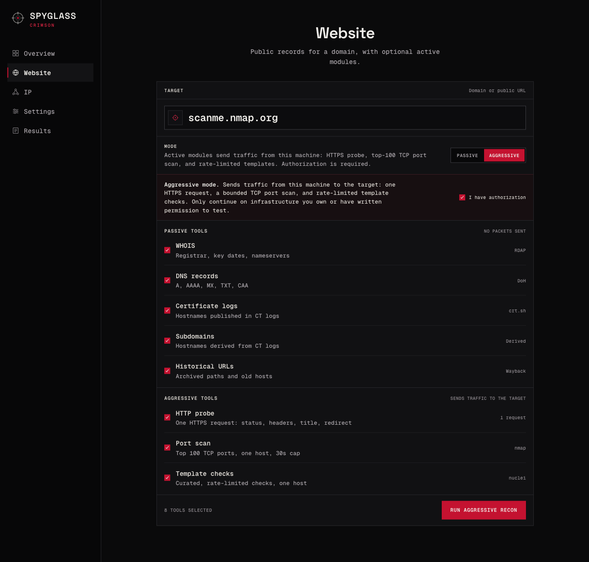
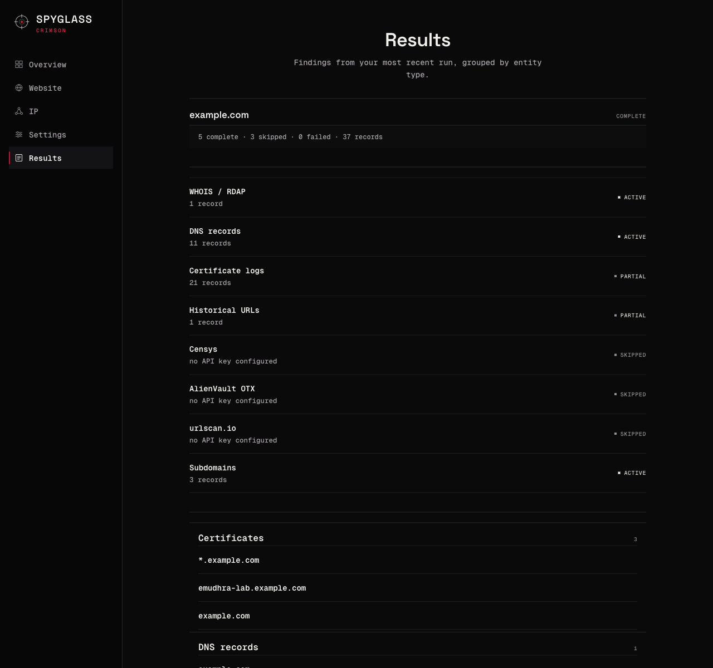

<div align="center">


# Spyglass-Crimson

**v1.0.0 “Crystal Pudding”** · released 2026-10-21 · [release notes](https://github.com/Ahmad170412/Spyglass-Crimson/releases/tag/v1.0.0)

**Passive OSINT for domains and IPs — 18 data sources, three bounded active modules when you ask for them.**  
Recon a domain or an IP address from public records alone: registration, DNS, certificate transparency, routing, historical URLs, reputation, and anonymity signals, correlated into one normalised entity graph.

[](https://github.com/Ahmad170412/Spyglass-Crimson/actions)
[](https://github.com/Ahmad170412/Spyglass-Crimson/releases/tag/v1.0.0)
[](LICENSE)
[](https://www.python.org/)
[](https://flask.palletsprojects.com/)
[](https://github.com/Ahmad170412/Spyglass-Crimson/actions)

[**Report Bug**](https://github.com/Ahmad170412/Spyglass-Crimson/issues/new/choose) · [**Request Feature**](https://github.com/Ahmad170412/Spyglass-Crimson/issues/new/choose) · [**Ethics & Acceptable Use**](ETHICS.md)

</div>

---

## About this release

**v1.0.0 “Crystal Pudding”** is the first stable release of Spyglass-Crimson. It
is a complete local application: passive recon works with no API keys, the
optional keyed providers degrade to an explicit skip reason, and the active
modules are gated behind recorded authorization.

- **18 sources, settled scope** — 10 keyless core sources, 5 optional enrichment
  providers, and 3 gated active modules.
- **Active means authorized and bounded.** The optional modules are an HTTPS probe,
  a top-100 TCP port scan (`nmap`), and curated template checks (`nuclei`). They
  run only with a recorded authorization for that exact target, refuse non-public
  address space, and are capped by time, rate, and scope. Port scanning without
  authorization may be illegal — see [ETHICS.md](ETHICS.md).
- **Local by design.** A single Flask process bound to `127.0.0.1`, no
  authentication layer, no telemetry. Do not expose it to a network.
- **Tested on Linux and Windows** across Python 3.9–3.12, plus local verification
  on newer Python releases.

Release notes and source archives live on the
[v1.0.0 release page](https://github.com/Ahmad170412/Spyglass-Crimson/releases/tag/v1.0.0).

## Why Spyglass-Crimson?

- **Zero-key by default** — 10 of 18 sources need no account, no API key, and no configuration. Clone, run, and it works.
- **Passive by default, provably** — it queries *third-party* public indexes (RDAP, crt.sh, DoH resolvers, Wayback, Tor, Spamhaus). It never connects to your target unless you explicitly enable an active module, and only after you record an authorization for that exact target.
- **Honest partial results** — every source reports `ok`, `partial`, `empty`, `not_found`, `skipped`, or `error` with a reason. A source that needs a key says *"no API key configured"* instead of silently vanishing.
- **Keys stay off disk and off the wire** — provider keys resolve from environment → OS keyring → a `0600` fallback file, never enter SQLite, and are never returned by the API.
- **One local app, no telemetry** — a single Flask process on `127.0.0.1`. It talks to public datasets, and to the target only when you explicitly authorize an active module.

<p align="center">
  
</p>

---

## Table of Contents

- [About this release](#about-this-release)
- [Why Spyglass-Crimson?](#why-spyglass-crimson)
- [Quick Start](#quick-start)
- [Architecture](#architecture)
- [Features](#features)
- [Installation](#installation)
- [Configuration](#configuration)
- [Usage](#usage)
- [Testing](#testing)
- [Repository Structure](#repository-structure)
- [Contributing](#contributing)
- [Security](#security)
- [Ethics](#ethics)
- [License](#license)

---

## Quick Start

```bash
git clone https://github.com/Ahmad170412/Spyglass-Crimson.git
cd Spyglass-Crimson
python3 -m venv .venv && source .venv/bin/activate
pip install -r requirements.txt

# Start the local dashboard (binds 127.0.0.1 only)
python app.py
```

Open <http://127.0.0.1:5000>, enter a domain or IP in the **Website** or **IP** tab, and press **Run passive recon**. No API keys required. The three active modules are opt-in and need `nmap`/`nuclei` on `PATH` — see [Installation](#installation).

```bash
# Or drive it from the terminal — same orchestrator, same results
curl -s -X POST http://127.0.0.1:5000/api/runs \
  -H 'Content-Type: application/json' \
  -d '{"target":"example.com","mode":"website"}'

# Poll until the run finishes
curl -s http://127.0.0.1:5000/api/runs/<run_id>/results
```

---

## Architecture

```text
                        ┌──────────────────────────────────────┐
   domain / IP  ───────▶│  Orchestrator  (spyglass/orchestrator)│
                        │  plan → budget → sources            │
                        └───────────────┬──────────────────────┘
                                        │
        ┌───────────────┬───────────────┼───────────────┬───────────────┐
        ▼               ▼               ▼               ▼               ▼
   ┌─────────┐    ┌─────────┐    ┌──────────┐    ┌──────────┐    ┌──────────┐
   │  RDAP   │    │   DNS   │    │    CT    │    │   ASN    │    │ InternetDB│
   │ rdap.org│    │DoH/1.1.1│    │  crt.sh  │    │ RIPEStat │    │  Shodan   │
   └────┬────┘    └────┬────┘    └────┬─────┘    └────┬─────┘    └────┬─────┘
        │              │             │              │               │
        └──────────────┴──────┬──────┴──────────────┴───────────────┘
                              ▼
                   ┌─────────────────────┐
                   │  extract_entities()  │   ← normalisation + correlation
                   └──────────┬──────────┘
                              ▼
                   ┌─────────────────────┐
                   │   SQLite  (local)   │   runs · source_runs
                   │  entities · obs.    │   entities · observations
                   └──────────┬──────────┘
                              ▼
                   ┌─────────────────────┐
                   │  REST API + dashboard│   /api/runs/<id>/results
                   └─────────────────────┘
```

Three rules shape the whole design:

1. **A failing source never kills a run.** Each source runs under its own timeout and error handler; a timeout is recorded as `error` with the elapsed budget, and the run continues. Per-source health is persisted so the dashboard can show a source that is currently failing.
2. **Derived sources run last.** `subdomains` depends on certificate-transparency output, so the orchestrator defers it until every independent source has finished.
3. **Only active modules talk to the target.** `http`, `nmap`, and `nuclei` are planned only when the caller asks for an aggressive run *and* a recorded authorization covers the target — re-checked again at execution time. Everything else queries third-party indexes.

---

## Features

| Feature | Description |
|---|---|
| **Website recon** | Domain or public URL → registration, DNS, CT, subdomains, historical URLs |
| **IP recon** | IPv4, IPv6, CIDR, or ASN → RDAP, routing, PTR, InternetDB, Tor exit status, Spamhaus DROP |
| **18 registered sources** | 10 keyless core + 5 optional-key enrichment + 3 gated active modules |
| **Normalised entities** | `hostname`, `ip`, `certificate`, `registration`, `dns`, `asn`, `host`, `enrichment` — one shape across every source |
| **Explicit skip reasons** | Keyed sources report *why* they were skipped, never fail silently |
| **Run history** | Every run, its per-source status, and its results persist locally and reload on page open |
| **Key management** | Save, test, and remove provider keys from the dashboard; values never reach the browser |
| **Run budget** | Configurable wall-clock budget caps a run; exhausted sources are marked, not retried |
| **Response cache** | Per-source TTL cache in SQLite keeps repeat lookups fast and polite to upstream APIs |
| **Active-module gate** | Every active module requires a recorded, unexpired authorization for that exact target |

### Core sources (no key required)

| Source | Layer | What it contributes |
|---|---|---|
| WHOIS / RDAP | `rdap.org` | Registration, registrar, dates, status, nameservers, DNSSEC |
| DNS records | DoH (Cloudflare, Google) | A, AAAA, NS, MX, TXT/SPF, CAA, SOA, DMARC |
| Certificate logs | `crt.sh` → Cert Spotter | Certificate history, issued hostnames |
| Subdomains | derived from CT | Unique hostnames extracted from transparency logs |
| ASN & routing | IANA, RIPEstat | Origin ASN, announced prefix, country, registry, AS name |
| Reverse DNS | DoH | PTR records for an address |
| Shodan InternetDB | `internetdb.shodan.io` | Keyless ports, hostnames, tags, and CVEs |
| Historical URLs | Wayback CDX | Archived URLs and historical hosts |
| Tor exits | `check.torproject.org` | Whether an IPv4 address is a current Tor exit node |
| Spamhaus DROP | `spamhaus.org/drop` | Hijacked and bulletproof-hosting netblocks |

### Enrichment sources (optional key)

| Source | Variable | Adds |
|---|---|---|
| Shodan API | `SPYGLASS_SHODAN_KEY` | Banner and service detail beyond the keyless dataset |
| Censys | `SPYGLASS_CENSYS_KEY` | Host and certificate index lookups, with a credit cap |
| IPinfo Lite | `SPYGLASS_IPINFO_TOKEN` | ASN, country, and continent enrichment |
| AlienVault OTX | `SPYGLASS_OTX_KEY` | Passive DNS history for subdomain pivots |
| urlscan.io | `SPYGLASS_URLSCAN_KEY` | Historical page scans and metadata |

### Active modules (authorization required)

| Source | Sends | What it contributes |
|---|---|---|
| HTTP probe | One HTTPS `GET` to `/` | Status code, server, content type, page title, redirect target, and which security headers are missing |
| Port scan (`nmap`) | Top 100 TCP connect ports, one host | Open ports with service guesses; no OS detection, NSE scripts, UDP, or host-discovery sweeps |
| Template checks (`nuclei`) | Curated, rate-limited HTTP templates, one host | Detection-only findings from `cve`, `exposure`, `misconfig`, `tech`, `headers`, and `ssl` templates |

All three refuse any address that is not globally routable (loopback, RFC 1918,
CGNAT, link-local, reserved) and refuse to run unless a recorded, unexpired
authorization exists for that exact target — checked server-side when the plan is
built, again at execution, and again inside each module. The HTTP probe follows no
redirects and reads at most 64 KiB; nmap is capped at the top 100 ports and 30
seconds; nuclei is capped at 20 requests per second, 30 seconds, 50 findings, with
`dos`, `fuzz`, `intrusive`, `brute-force`, and `default-login` templates excluded
and out-of-band interaction disabled. Active modules never accept CIDR or ASN
ranges. See [ETHICS.md](ETHICS.md).

---

## Installation

Requires **Python 3.9 or newer** (CI covers 3.9–3.12 on Linux and Windows) and a POSIX-ish or Windows host. The tool is a local server — there is no PyPI package and nothing to install globally.

### From source (recommended)

```bash
git clone https://github.com/Ahmad170412/Spyglass-Crimson.git
cd Spyglass-Crimson
python3 -m venv .venv
source .venv/bin/activate        # Windows: .venv\Scripts\activate
pip install -r requirements.txt
python app.py
```

### With the test suite

```bash
pip install -r requirements-dev.txt
pytest
```

### Optional: the `nmap` and `nuclei` binaries

Passive recon needs nothing beyond Python. The port-scan and template-check
modules shell out to external binaries, so they stay disabled — and record a
skip reason — until the binary is on `PATH`.

```bash
# macOS
brew install nmap nuclei

# Debian / Ubuntu
sudo apt install nmap
# nuclei: grab a release build from https://github.com/projectdiscovery/nuclei/releases

# Windows: install from https://nmap.org/download.html and the nuclei releases page
```

Then fetch the template set once (the templates are not bundled):

```bash
nuclei -update-templates
```

### Choose the port and data directory

```bash
PORT=8080 SPYGLASS_INSTANCE=~/spyglass-data python app.py
```

The instance directory holds the SQLite database and the credential fallback file. It is created on first run and should stay out of version control.

---

## Configuration

Every setting has a working default. **All API keys are optional** — the tool is fully functional without them.

| Variable | Required | Default | Notes |
|---|---|---|---|
| `SPYGLASS_INSTANCE` | No | `./instance` | Data directory (DB + credential fallback) |
| `SPYGLASS_DB` | No | `$SPYGLASS_INSTANCE/spyglass.db` | Override the SQLite path |
| `SPYGLASS_CREDENTIALS` | No | `$SPYGLASS_INSTANCE/credentials.json` | `0600` keyring fallback file |
| `SPYGLASS_KEYRING` | No | `1` | Set `0` to disable the OS keyring |
| `SPYGLASS_SHODAN_KEY` | No | — | Enables the Shodan source |
| `SPYGLASS_CENSYS_KEY` | No | — | Enables the Censys source |
| `SPYGLASS_IPINFO_TOKEN` | No | — | Enables the IPinfo source |
| `SPYGLASS_OTX_KEY` | No | — | Enables the OTX source |
| `SPYGLASS_URLSCAN_KEY` | No | — | Enables the urlscan source |
| `SPYGLASS_RUN_BUDGET` | No | `60` | Wall-clock budget per run, in seconds |
| `SPYGLASS_SOURCE_TIMEOUT` | No | `20` | Per-source timeout, in seconds |
| `SPYGLASS_HTTP_TIMEOUT` | No | `10` | Per-request timeout, in seconds |
| `SPYGLASS_HTTP_RETRIES` | No | `1` | Retries for transient transport errors |
| `SPYGLASS_MAX_IPS` | No | `25` | Cap on addresses sampled from a CIDR |
| `SPYGLASS_MAX_CIDR_HOSTS` | No | `512` | Largest CIDR that will be expanded |
| `SPYGLASS_MAX_CT_NAMES` | No | `200` | Cap on hostnames kept from CT logs |
| `SPYGLASS_MAX_CT_CERTS` | No | `500` | Cap on certificates parsed from CT logs |
| `SPYGLASS_MAX_WAYBACK_URLS` | No | `500` | Cap on archived URLs kept from Wayback |
| `SPYGLASS_MAX_ASN_PREFIXES` | No | `100` | Cap on announced prefixes per ASN |
| `SPYGLASS_MAX_CENSYS_LOOKUPS` | No | `10` | Credit cap on Censys lookups per run |
| `SPYGLASS_USER_AGENT` | No | `Spyglass-Crimson/1.0.0 (passive OSINT; local tool)` | Identify yourself to upstream APIs |
| `SPYGLASS_DNS_TTL` | No | `3600` | DNS cache TTL, in seconds |
| `SPYGLASS_CT_TTL` | No | `43200` | Certificate-transparency cache TTL |
| `SPYGLASS_RDAP_TTL` | No | `86400` | RDAP cache TTL |
| `SPYGLASS_INTERNETDB_TTL` | No | `86400` | InternetDB cache TTL |
| `SPYGLASS_WAYBACK_TTL` | No | `86400` | Wayback cache TTL |
| `SPYGLASS_ROUTING_TTL` | No | `21600` | ASN/routing cache TTL |
| `SPYGLASS_BOOTSTRAP_TTL` | No | `86400` | Bootstrap/registry cache TTL |
| `SPYGLASS_WAYBACK_TIMEOUT` | No | `30` | Timeout for the Wayback CDX index, in seconds |
| `SPYGLASS_TOR_TTL` | No | `3600` | Tor exit-list cache TTL |
| `SPYGLASS_DROP_TTL` | No | `86400` | Spamhaus DROP cache TTL |
| `SPYGLASS_AUTHORIZATION_TTL` | No | `30` | Default authorization lifetime, in days |
| `SPYGLASS_NMAP_TOP_PORTS` | No | `100` | Ports scanned per nmap run (hard cap `1000`) |
| `SPYGLASS_NMAP_TIMEOUT` | No | `30` | nmap host timeout, in seconds |
| `SPYGLASS_NUCLEI_TIMEOUT` | No | `30` | nuclei per-request timeout, in seconds |
| `SPYGLASS_NUCLEI_RATE_LIMIT` | No | `20` | nuclei requests per second (hard cap `100`) |
| `SPYGLASS_MAX_NUCLEI_FINDINGS` | No | `50` | Findings recorded per nuclei run |
| `SPYGLASS_NUCLEI_EXCLUDE_TAGS` | No | `dos,fuzz,intrusive,brute-force,default-login` | Template tags to exclude |
| `SPYGLASS_ALLOWED_HOSTS` | No | `127.0.0.1,localhost,::1` | Host headers the dashboard accepts (DNS-rebinding guard) |

```bash
# Linux / macOS
export SPYGLASS_SHODAN_KEY="your-key"

# Windows PowerShell
$env:SPYGLASS_SHODAN_KEY = "your-key"
```

Prefer the dashboard? **Settings → Add key** stores the value in your OS keyring and never renders it back into the page.

---

## Usage

<p align="center">
  
</p>

### Website recon

```bash
curl -s -X POST http://127.0.0.1:5000/api/runs \
  -H 'Content-Type: application/json' \
  -d '{"target":"example.com","mode":"website"}'
```

```json
{
  "id": "82288a06c4f8",
  "target": "example.com",
  "plan": [
    "rdap", "dns", "ct", "wayback",
    "censys", "otx", "urlscan",
    "subdomains"
  ],
  "status": "queued"
}
```

The plan is the full source list for the target's kind. Keyed sources appear
in it and are skipped at run time with a recorded reason if no key is
configured.

### IP recon

```bash
curl -s -X POST http://127.0.0.1:5000/api/runs \
  -H 'Content-Type: application/json' \
  -d '{"target":"1.1.1.1","mode":"passive"}'
```

### Choose sources

Pass `sources` to narrow the passive plan. Enrichment providers stay planned (and
report their own skip reason when no key is configured), and derived sources such
as `subdomains` always run last.

```bash
curl -s -X POST http://127.0.0.1:5000/api/runs \
  -H 'Content-Type: application/json' \
  -d '{"target":"example.com","mode":"website","sources":["rdap","ct"]}'
```

### Aggressive run (authorization required)

The active modules send real traffic: one HTTPS request, a bounded top-100 TCP
connect scan, and rate-limited template checks. Record an authorization for the
exact target first, then ask for an aggressive run:

```bash
curl -s -X POST http://127.0.0.1:5000/api/authorizations \
  -H 'Content-Type: application/json' \
  -d '{"target":"example.com","note":"client engagement 2026-004","ttl_days":14}'

curl -s -X POST http://127.0.0.1:5000/api/runs \
  -H 'Content-Type: application/json' \
  -d '{"target":"example.com","mode":"website","aggressive":true}'
```

Without a matching, unexpired record the second call returns `403`. The plan gains
`http`, `nmap`, and `nuclei`; each records a skip reason if its binary is not
installed. `sources` narrows the passive plan only — active modules are opt-in via
`aggressive`. Pass `active_sources` to run only some of them, for example
`{"target":"example.com","aggressive":true,"active_sources":["nmap"]}`.
The `nmap` and `nuclei` binaries are optional — install them as described in
[Installation](#installation); without them the modules report a skip reason
instead of failing the run.

### Read the results

<p align="center">
  
</p>

```bash
curl -s http://127.0.0.1:5000/api/runs/82288a06c4f8/results
```

```json
{
  "run": { "status": "complete", "target": "example.com" },
  "summary": { "sources_total": 8, "complete": 5, "failed": 0, "skipped": 3, "records": 37 },
  "source_runs": [
    { "source": "rdap", "status": "ok", "record_count": 1 },
    { "source": "dns", "status": "ok", "record_count": 11 },
    { "source": "ct", "status": "partial", "record_count": 21 },
    { "source": "censys", "status": "skipped", "error": "no API key configured" }
  ],
  "entities": [
    { "kind": "ip", "key": "104.20.23.154" },
    { "kind": "hostname", "key": "www.example.com" },
    { "kind": "registration", "key": "example.com" }
  ],
  "observations": []
}
```

### API surface

| Method | Endpoint | Purpose |
|---|---|---|
| `GET` | `/api/health` | Liveness, database state, source count |
| `GET` | `/api/sources` | Source registry with per-source health |
| `GET` | `/api/sources/<id>` | One source's metadata |
| `POST` | `/api/runs` | Start a run (`target`, `mode`, `layer`, `sources`, `aggressive`, `active_sources`) |
| `GET` | `/api/runs` | List recent runs |
| `GET` | `/api/runs/<id>` | Run status and per-source summary |
| `GET` | `/api/runs/<id>/results` | Full results: sources, entities, observations |
| `GET` | `/api/credentials` | Which providers have a key (never the value) |
| `PUT` | `/api/credentials/<provider>` | Store a key |
| `DELETE` | `/api/credentials/<provider>` | Remove a key |
| `POST` | `/api/credentials/<provider>/test` | Validate a key against the provider |
| `GET`/`POST` | `/api/authorizations` | Authorization records (`target`, optional `note`, optional `ttl_days`) |
| `GET` | `/api/aggressive-gate` | Whether the current target is authorized |

---

## Testing

```bash
pip install -r requirements-dev.txt
pytest
```

The suite is fully mocked — `respx` intercepts HTTP and `monkeypatch` stubs the client — so **it never touches the network** and runs identically offline and in CI.

```bash
pytest -v                    # verbose
pytest tests/test_run_api.py # a single module
pytest -k keyed              # only the enrichment-provider tests
```

| Suite | Covers |
|---|---|
| `test_validation.py` | Target parsing and rejection rules |
| `test_rdap.py` | Registration lookups and normalisation |
| `test_dns.py` | DNS record retrieval and parsing |
| `test_ct.py` | Certificate-transparency parsing |
| `test_asn.py` | ASN and routing lookups |
| `test_ptr_internetdb_wayback.py` | PTR, InternetDB, and Wayback sources |
| `test_datasets.py` | Tor exit list and Spamhaus DROP: matching, caching, degraded datasets |
| `test_http_probe.py` | HTTP probe: gate, private-address refusal, redirects, body cap |
| `test_active_scanners.py` | nmap and nuclei: gate, binary checks, command bounds, XML/JSONL parsing, finding cap |
| `test_keyed_sources.py` | All five enrichment providers: happy path, rejected key, caching |
| `test_orchestrator.py` | Planning, budget enforcement, derived sources |
| `test_hardening.py` | Host-header guard, authorization expiry, budget cutoff, source health, provenance, CIDR aggregation |
| `test_run_api.py` | Run lifecycle through the REST API |
| `test_storage_and_api.py` | Persistence, credentials, and API surface |

---

## Repository Structure

```text
Spyglass-Crimson/
├── README.md               # This file
├── CHANGELOG.md            # Release history
├── CONTRIBUTING.md         # How to contribute
├── SECURITY.md             # Reporting a vulnerability
├── ETHICS.md               # Acceptable-use policy — read before running
├── LICENSE                 # MIT
├── app.py                  # Local server entry point (127.0.0.1)
├── pytest.ini              # Test configuration
├── requirements.txt        # Runtime dependencies
├── requirements-dev.txt    # Test dependencies
├── .github/
│   └── workflows/ci.yml    # Test matrix: Ubuntu + Windows, Python 3.9–3.12
├── assets/
│   ├── logo.svg            # Project logo
│   ├── overview.png        # Source inventory
│   ├── website-form.png    # Website recon form
│   └── results.png         # Results view
├── spyglass/
│   ├── __init__.py         # Flask app factory
│   ├── api.py              # REST API blueprint
│   ├── orchestrator.py     # Run planning, execution, entity extraction
│   ├── db.py               # SQLite schema and queries
│   ├── cache.py            # TTL response cache
│   ├── config.py           # Settings and environment handling
│   ├── credentials.py      # Keyring-backed credential store
│   ├── http.py             # httpx wrapper with retries and caching
│   ├── models.py           # Target, SourceResult, SourceContext
│   ├── services.py         # Shared SourceContext construction
│   ├── validation.py       # Target parsing
│   ├── doh.py              # DNS-over-HTTPS helpers
│   └── sources/            # One module per data source
├── static/
│   ├── css/app.css         # Dashboard styles
│   └── js/app.js           # Dashboard logic
├── templates/index.html    # Single-page dashboard
└── tests/                  # Test suite
```

---

## Contributing

Contributions are welcome — issues and pull requests are open. Read
[ETHICS.md](ETHICS.md) first: contributions that weaken the passive
default, widen the active modules beyond their documented bounds, or bypass the
authorization gate will be declined.

1. Fork the repository and create a branch (`git checkout -b feat/my-change`).
2. Add or update tests for the behaviour you changed — the suite must stay green and network-free.
3. Keep the boundary intact: `http`, `nmap`, and `nuclei` are the only modules allowed to send traffic to a target, and only through the recorded-authorization gate — no unbounded sweeps, fuzzing, or payloads.
4. Run the quality gate: `pytest`.
5. Open a pull request describing what changed and why.

See [CONTRIBUTING.md](CONTRIBUTING.md) for the full guidelines.

---

## Security

Found a vulnerability? Please report it privately as described in
[SECURITY.md](SECURITY.md) rather than opening a public issue. Please include
reproduction steps and the affected version.

---

## Ethics

This tool queries public datasets about infrastructure you may not own. That is only legitimate when you own the target or have explicit authorization to assess it.

**Read [ETHICS.md](ETHICS.md) before you run this against anything that is not yours.** It sets the authorization requirement, the passive-by-default rule, the bounds on each active module, data-handling duties, and the consequences of misuse. The short version: run it against your own infrastructure or targets you are explicitly authorized to assess, stay passive unless you have recorded authorization, and respect people's privacy. You are solely responsible for how you use it.

---

## License

MIT License — see [LICENSE](LICENSE) for details.

Copyright (c) 2026 Team Leader.
