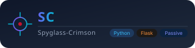

<div align="center">



# Spyglass-Crimson

**Passive OSINT for domains and IPs — 13 data sources, zero packets sent to the target.**  
Recon a domain or an IP address from public records alone: registration, DNS, certificate transparency, routing, and historical URLs, correlated into one normalised entity graph.

[](https://github.com/Ahmad170412/Spyglass-Crimson/actions)
[](LICENSE)
[](https://www.python.org/)
[](https://flask.palletsprojects.com/)
[](https://github.com/Ahmad170412/Spyglass-Crimson/actions)
[](CONTRIBUTING.md)

[**Report Bug**](../../issues) · [**Request Feature**](../../issues) · [**Ethics & Acceptable Use**](ETHICS.md)

</div>

---

## Why Spyglass-Crimson?

- **Zero-key by default** — 8 of 13 sources need no account, no API key, and no configuration. Clone, run, and it works.
- **Passive, provably** — it queries *third-party* public indexes (RDAP, crt.sh, DoH resolvers, Wayback). It never connects to your target. The aggressive mode is gated behind a recorded authorization and is not wired to a scanner.
- **Honest partial results** — every source reports `ok`, `partial`, `empty`, `skipped`, or `error` with a reason. A source that needs a key says *"no API key configured"* instead of silently vanishing.
- **Keys stay off disk and off the wire** — provider keys resolve from environment → OS keyring → a `0600` fallback file, never enter SQLite, and are never returned by the API.
- **One local app, no telemetry** — a single Flask process on `127.0.0.1`. It talks to public datasets and nowhere else.

---

## Table of Contents

- [Quick Start](#quick-start)
- [Architecture](#architecture)
- [Features](#features)
- [Installation](#installation)
- [Configuration](#configuration)
- [Usage](#usage)
- [Testing](#testing)
- [Repository Structure](#repository-structure)
- [Contributing](#contributing)
- [Ethics](#ethics)
- [License](#license)

---

## Quick Start

```bash
git clone https://github.com/Ahmad170412/Spyglass-Crimson.git
cd Spyglass-Crimson
python3 -m venv .venv && source .venv/bin/activate
pip install -r requirements.txt

# Start the local dashboard (binds 127.0.0.1 only)
python app.py
```

Open <http://127.0.0.1:5000>, enter a domain or IP in the **Website** or **IP** tab, and press **Run Passive Recon**. No API keys required.

```bash
# Or drive it from the terminal — same orchestrator, same results
curl -s -X POST http://127.0.0.1:5000/api/runs \
  -H 'Content-Type: application/json' \
  -d '{"target":"example.com","mode":"website"}'

# Poll until the run finishes
curl -s http://127.0.0.1:5000/api/runs/<run_id>/results
```

---

## Architecture

```text
                        ┌──────────────────────────────────────┐
   domain / IP  ───────▶│  Orchestrator  (spyglass/orchestrator)│
                        │  plan → budget → parallel sources    │
                        └───────────────┬──────────────────────┘
                                        │
        ┌───────────────┬───────────────┼───────────────┬───────────────┐
        ▼               ▼               ▼               ▼               ▼
   ┌─────────┐    ┌─────────┐    ┌──────────┐    ┌──────────┐    ┌──────────┐
   │  RDAP   │    │   DNS   │    │    CT    │    │   ASN    │    │ InternetDB│
   │ rdap.org│    │DoH/1.1.1│    │  crt.sh  │    │ RIPEStat │    │  Shodan   │
   └────┬────┘    └────┬────┘    └────┬─────┘    └────┬─────┘    └────┬─────┘
        │              │             │              │               │
        └──────────────┴──────┬──────┴──────────────┴───────────────┘
                              ▼
                   ┌─────────────────────┐
                   │  extract_entities()  │   ← normalisation + correlation
                   └──────────┬──────────┘
                              ▼
                   ┌─────────────────────┐
                   │   SQLite  (local)   │   runs · source_runs
                   │  entities · obs.    │   entities · observations
                   └──────────┬──────────┘
                              ▼
                   ┌─────────────────────┐
                   │  REST API + dashboard│   /api/runs/<id>/results
                   └─────────────────────┘
```

Two rules shape the whole design:

1. **A failing source never kills a run.** Each source runs under its own timeout and error handler; a timeout is recorded as `error` with the elapsed budget, and the run continues.
2. **Derived sources run last.** `subdomains` depends on certificate-transparency output, so the orchestrator defers it until every independent source has finished.

---

## Features

| Feature | Description |
|---|---|
| **Website recon** | Domain or public URL → registration, DNS, CT, subdomains, historical URLs |
| **IP recon** | IPv4, IPv6, CIDR, or ASN → RDAP, routing, PTR, InternetDB |
| **13 registered sources** | 8 keyless core + 5 optional-key enrichment providers |
| **Normalised entities** | `hostname`, `ip`, `certificate`, `registration`, `dns`, `asn`, `host`, `enrichment` — one shape across every source |
| **Explicit skip reasons** | Keyed sources report *why* they were skipped, never fail silently |
| **Run history** | Every run, its per-source status, and its results persist locally and reload on page open |
| **Key management** | Save, test, and remove provider keys from the dashboard; values never reach the browser |
| **Run budget** | Configurable wall-clock budget caps a run; exhausted sources are marked, not retried |
| **Response cache** | Per-source TTL cache in SQLite keeps repeat lookups fast and polite to upstream APIs |
| **Aggressive gate** | Active modes require a recorded, unexpired authorization for that exact target |

### Core sources (no key required)

| Source | Layer | What it contributes |
|---|---|---|
| WHOIS / RDAP | `rdap.org` | Registration, registrar, dates, status, nameservers, DNSSEC |
| DNS records | DoH (Cloudflare, Google) | A, AAAA, NS, MX, TXT/SPF, CAA, SOA, DMARC |
| Certificate logs | `crt.sh` → Cert Spotter | Certificate history, issued hostnames |
| Subdomains | derived from CT | Unique hostnames extracted from transparency logs |
| ASN & routing | IANA, RIPEstat | Origin ASN, announced prefix, country, registry, AS name |
| Reverse DNS | DoH | PTR records for an address |
| Shodan InternetDB | `internetdb.shodan.io` | Keyless ports, hostnames, tags, and CVEs |
| Historical URLs | Wayback CDX | Archived URLs and historical hosts |

### Enrichment sources (optional key)

| Source | Variable | Adds |
|---|---|---|
| Shodan API | `SPYGLASS_SHODAN_KEY` | Banner and service detail beyond the keyless dataset |
| Censys | `SPYGLASS_CENSYS_KEY` | Host and certificate index lookups, with a credit cap |
| IPinfo Lite | `SPYGLASS_IPINFO_TOKEN` | ASN, country, and continent enrichment |
| AlienVault OTX | `SPYGLASS_OTX_KEY` | Passive DNS history for subdomain pivots |
| urlscan.io | `SPYGLASS_URLSCAN_KEY` | Historical page scans and metadata |

---

## Installation

Requires **Python 3.9 or newer** (verified on 3.9 and 3.11) and a POSIX-ish or Windows host. The tool is a local server — there is no PyPI package and nothing to install globally.

### From source (recommended)

```bash
git clone https://github.com/Ahmad170412/Spyglass-Crimson.git
cd Spyglass-Crimson
python3 -m venv .venv
source .venv/bin/activate        # Windows: .venv\Scripts\activate
pip install -r requirements.txt
python app.py
```

### With the test suite

```bash
pip install -r requirements-dev.txt
pytest
```

### Choose the port and data directory

```bash
PORT=8080 SPYGLASS_INSTANCE=~/spyglass-data python app.py
```

The instance directory holds the SQLite database and the credential fallback file. It is created on first run and should stay out of version control.

---

## Configuration

Every setting has a working default. **All API keys are optional** — the tool is fully functional without them.

| Variable | Required | Default | Notes |
|---|---|---|---|
| `SPYGLASS_INSTANCE` | No | `./instance` | Data directory (DB + credential fallback) |
| `SPYGLASS_DB` | No | `$SPYGLASS_INSTANCE/spyglass.db` | Override the SQLite path |
| `SPYGLASS_CREDENTIALS` | No | `$SPYGLASS_INSTANCE/credentials.json` | `0600` keyring fallback file |
| `SPYGLASS_KEYRING` | No | `1` | Set `0` to disable the OS keyring |
| `SPYGLASS_SHODAN_KEY` | No | — | Enables the Shodan source |
| `SPYGLASS_CENSYS_KEY` | No | — | Enables the Censys source |
| `SPYGLASS_IPINFO_TOKEN` | No | — | Enables the IPinfo source |
| `SPYGLASS_OTX_KEY` | No | — | Enables the OTX source |
| `SPYGLASS_URLSCAN_KEY` | No | — | Enables the urlscan source |
| `SPYGLASS_RUN_BUDGET` | No | `60` | Wall-clock budget per run, in seconds |
| `SPYGLASS_SOURCE_TIMEOUT` | No | `20` | Per-source timeout, in seconds |
| `SPYGLASS_HTTP_TIMEOUT` | No | `10` | Per-request timeout, in seconds |
| `SPYGLASS_HTTP_RETRIES` | No | `1` | Retries for transient transport errors |
| `SPYGLASS_MAX_IPS` | No | `25` | Cap on addresses sampled from a CIDR |
| `SPYGLASS_USER_AGENT` | No | `Spyglass-Crimson/0.2` | Identify yourself to upstream APIs |
| `SPYGLASS_DNS_TTL` | No | `3600` | DNS cache TTL, in seconds |
| `SPYGLASS_CT_TTL` | No | `43200` | Certificate-transparency cache TTL |
| `SPYGLASS_RDAP_TTL` | No | `86400` | RDAP cache TTL |
| `SPYGLASS_INTERNETDB_TTL` | No | `86400` | InternetDB cache TTL |
| `SPYGLASS_WAYBACK_TTL` | No | `86400` | Wayback cache TTL |

```bash
# Linux / macOS
export SPYGLASS_SHODAN_KEY="your-key"

# Windows PowerShell
$env:SPYGLASS_SHODAN_KEY = "your-key"
```

Prefer the dashboard? **Settings → Add key** stores the value in your OS keyring and never renders it back into the page.

---

## Usage

### Website recon

```bash
curl -s -X POST http://127.0.0.1:5000/api/runs \
  -H 'Content-Type: application/json' \
  -d '{"target":"example.com","mode":"website"}'
```

```json
{
  "id": "82288a06c4f8",
  "target": "example.com",
  "target_kind": "domain",
  "plan": ["rdap", "dns", "ct", "wayback", "subdomains"],
  "status": "queued"
}
```

### IP recon

```bash
curl -s -X POST http://127.0.0.1:5000/api/runs \
  -H 'Content-Type: application/json' \
  -d '{"target":"1.1.1.1","mode":"passive"}'
```

### Read the results

```bash
curl -s http://127.0.0.1:5000/api/runs/82288a06c4f8/results
```

```json
{
  "run": { "status": "complete", "target": "example.com" },
  "summary": { "sources_total": 8, "complete": 5, "failed": 0, "skipped": 3, "records": 28 },
  "source_runs": [
    { "source": "rdap", "status": "ok", "record_count": 1 },
    { "source": "dns", "status": "ok", "record_count": 11 },
    { "source": "censys", "status": "skipped", "error": "no API key configured" }
  ],
  "entities": [
    { "kind": "ip", "key": "104.20.23.154" },
    { "kind": "hostname", "key": "www.example.com" },
    { "kind": "registration", "key": "example.com" }
  ],
  "observations": []
}
```

### API surface

| Method | Endpoint | Purpose |
|---|---|---|
| `GET` | `/api/health` | Liveness, database state, source count |
| `GET` | `/api/sources` | Source registry with per-source health |
| `GET` | `/api/sources/<id>` | One source's metadata |
| `POST` | `/api/runs` | Start a run (`target`, `mode`, `layer`) |
| `GET` | `/api/runs` | List recent runs |
| `GET` | `/api/runs/<id>` | Run status and per-source summary |
| `GET` | `/api/runs/<id>/results` | Full results: sources, entities, observations |
| `GET` | `/api/credentials` | Which providers have a key (never the value) |
| `PUT` | `/api/credentials/<provider>` | Store a key |
| `DELETE` | `/api/credentials/<provider>` | Remove a key |
| `POST` | `/api/credentials/<provider>/test` | Validate a key against the provider |
| `GET`/`POST` | `/api/authorizations` | Aggressive-mode authorization records |
| `GET` | `/api/aggressive-gate` | Whether the current target is authorized |

---

## Testing

```bash
pip install -r requirements-dev.txt
pytest
```

The suite is fully mocked — `respx` intercepts HTTP and `monkeypatch` stubs the client — so **it never touches the network** and runs identically offline and in CI.

```bash
pytest -v                    # verbose
pytest tests/test_run_api.py # a single module
pytest -k keyed              # only the enrichment-provider tests
```

| Suite | Covers |
|---|---|
| `test_validation.py` | Target parsing and rejection rules |
| `test_rdap.py` | Registration lookups and normalisation |
| `test_dns.py` | DNS record retrieval and parsing |
| `test_ct.py` | Certificate-transparency parsing |
| `test_asn.py` | ASN and routing lookups |
| `test_ptr_internetdb_wayback.py` | PTR, InternetDB, and Wayback sources |
| `test_keyed_sources.py` | All five enrichment providers: happy path, rejected key, caching |
| `test_orchestrator.py` | Planning, budget enforcement, derived sources |
| `test_run_api.py` | Run lifecycle through the REST API |
| `test_storage_and_api.py` | Persistence, credentials, and API surface |

---

## Repository Structure

```text
Spyglass-Crimson/
├── README.md               # This file
├── CHANGELOG.md            # Release history
├── CONTRIBUTING.md         # How to contribute
├── SECURITY.md             # Reporting a vulnerability
├── ETHICS.md               # Acceptable-use policy — read before running
├── LICENSE                 # MIT
├── app.py                  # Local server entry point (127.0.0.1)
├── pytest.ini              # Test configuration
├── requirements.txt        # Runtime dependencies
├── requirements-dev.txt    # Test dependencies
├── assets/
│   ├── logo.svg            # Project logo
│   ├── overview.png        # Source inventory
│   ├── website-form.png    # Website recon form
│   └── results.png         # Results view
├── spyglass/
│   ├── __init__.py         # Flask app factory
│   ├── api.py              # REST API blueprint
│   ├── orchestrator.py     # Run planning, execution, entity extraction
│   ├── db.py               # SQLite schema and queries
│   ├── cache.py            # TTL response cache
│   ├── config.py           # Settings and environment handling
│   ├── credentials.py      # Keyring-backed credential store
│   ├── http.py             # httpx wrapper with retries and caching
│   ├── models.py           # Target, SourceResult, SourceContext
│   ├── validation.py       # Target parsing
│   ├── doh.py              # DNS-over-HTTPS helpers
│   └── sources/            # One module per data source
├── static/
│   ├── css/app.css         # Dashboard styles
│   └── js/app.js           # Dashboard logic
├── templates/index.html    # Single-page dashboard
└── tests/                  # Test suite
```

---

## Contributing

Contributions are welcome. Please read [ETHICS.md](ETHICS.md) first — contributions that weaken the passive-only boundary or the authorization gate will be declined.

1. Fork the repository and create a branch (`git checkout -b feat/my-change`).
2. Add or update tests for the behaviour you changed — the suite must stay green and network-free.
3. Keep the passive boundary intact: no code that sends traffic to a target.
4. Run the quality gate: `pytest`.
5. Open a pull request describing what changed and why.

See [CONTRIBUTING.md](CONTRIBUTING.md) for the full guidelines.

---

## Ethics

This tool queries public datasets about infrastructure you may not own. That is only legitimate when you own the target or have explicit authorization to assess it.

**Read [ETHICS.md](ETHICS.md) before you run this against anything that is not yours.** It sets the authorization requirement, the passive-only boundary, data-handling duties, and the consequences of misuse. The short version: run it against your own infrastructure or targets you are explicitly authorized to assess, keep it passive, and respect people's privacy. You are solely responsible for how you use it.

---

## License

MIT License — see [LICENSE](LICENSE) for details.

Copyright (c) 2026 Team Leader.
